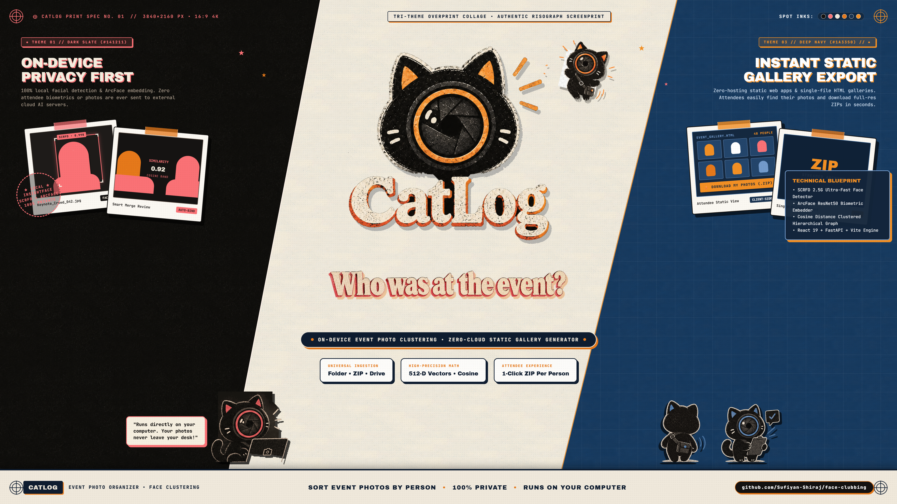

# CatLog

<p align="center">
  
</p>

<p align="center">
  <strong>Who was at the event?</strong><br>
  <em>The privacy-first event photo organizer, face clustering engine, and static gallery generator.</em>
</p>

<p align="center">
  
  
  
  
  
  
</p>

---

## Overview

CatLog is a privacy-first desktop application and static site generator created for event organizers, conference producers, and photographers. 

Organizers point CatLog at an event's photo collection (from local folders, ZIP files, or Google Drive links). The on-device engine detects faces, extracts mathematical embedding vectors via InsightFace (SCRFD + ArcFace ResNet50), groups attendees into high-precision clusters, and offers a visual review interface with smart merging suggestions and triage. 

Finally, CatLog exports lightweight static web galleries where attendees can browse, search for their name, and download their photos directly without file duplication.

---

## Key Capabilities

- **100% Local Processing & Privacy Guarantee**  
  All face detection, facial embedding, and clustering algorithms execute locally on your machine. Zero attendee biometrics, facial crops, or photos are ever sent to external cloud AI services.
- **Universal Source Ingestion**  
  Scan photos from local disk folders, compressed ZIP archives, or public Google Drive shared folders via read-only Google Drive API v3 (no OAuth account login required). Google Drive ingestion seamlessly traverses nested subfolder hierarchies up to 5 levels deep with queue-based cycle prevention, file ID deduplication, and resilient non-fatal handling of inaccessible subfolders.
- **Detached Native Telemetry Window**  
  Pop the activity log out into an independent native desktop window or open the dedicated telemetry interface (`/logs.html`) featuring live Server-Sent Events (SSE) streaming, elapsed time clock, stage filters, and full text search.
- **Visual Review & Smart Assistance**  
  - Ranked Merge Suggestions: Surfaces attendee pairs with close facial embeddings in the 0.50 to 0.65 cosine distance band.
  - Unrecognized Face Triage: Quick-assign or batch-promote faces that did not automatically bind to existing clusters.
  - Full Undo / Redo: Experiment with manual merges and threshold adjustments with persistent edit replay.
- **Dual Export Modalities**  
  - Standalone Single-File HTML: An ultra-fast single HTML gallery file with embedded styling, thumbnails, and client-side filtering.
  - Static Web Bundle: A modern static React web app ready for free zero-cost hosting on GitHub Pages, Cloudflare Pages, AWS S3, or Netlify.
- **Static Viewer with Per-Person Downloads**  
  - Three Themes: Dark Slate, Riso Paper, and Deep Navy with persistent theme selection.
  - Per-Person Downloads: Attendees can download all photos in one click or enter Select Mode to choose specific pictures.
  - Client-Side ZIP Streaming: Generates a single ZIP package directly in the browser with live progress and cancel controls.
  - Direct Google Drive Downloads: For Drive-backed events, downloads photos directly from Google Drive with zero server bandwidth overhead.
- **Resume Saved Projects**  
  Reopen previous events from the project library without re-scanning or re-embedding photos.

---

## Standalone Desktop Downloads

Pre-built portable packages are published for Windows, macOS, and Linux on [GitHub Releases](https://github.com/Sufiyan-Shiraj/face-clubbing/releases).

| Operating System | Package Archive | Platform Status | Format Details |
| :--- | :--- | :---: | :--- |
| **Windows (x64)** | `CatLog-0.1.0-rc1-windows-x64.zip` | **Stable** | Portable folder package (`CatLog.exe` + `_internal/`). Instant cold launch (~1.6s). |
| **Windows (Onefile)** | `CatLog-0.1.0-rc1-windows-x64-onefile.zip` | **Alternative** | Single standalone binary executable (`CatLog-onefile.exe`). |
| **macOS (Universal)** | `CatLog-0.1.0-rc1-macos-universal.zip` | **Beta** | Portable launcher bundle (`run.sh` + prebuilt UI). Apple Silicon & Intel compatible. |
| **Linux (x64)** | `CatLog-0.1.0-rc1-linux-x64.tar.gz` | **Beta** | Portable launcher archive (`run.sh` + prebuilt UI) with WebKitGTK and browser fallback. |
| **Verification** | `SHA256SUMS.txt` | &mdash; | SHA-256 integrity checksum manifest for all release files. |

### First-Run System Security Notes

Because CatLog is an open-source binary distributed without commercial code-signing certificates:
- **Windows**: Windows SmartScreen may display an alert. Click **More info** and select **Run anyway**.
- **macOS**: Gatekeeper may state the developer cannot be verified. Right-click `run.sh` (or `CatLog`), select **Open**, and confirm. Alternatively, grant permission in *System Settings > Privacy & Security*.
- **Linux**: Extract the archive and execute `chmod +x run.sh && ./run.sh`. If WebKitGTK is not present, CatLog automatically opens in your default web browser.

### Deep Learning Models (Downloaded on First Run)
To keep release downloads portable (~150 MB) and adhere strictly to upstream licensing terms:
- Pre-trained model weights are not packed inside the binary.
- On first launch, CatLog downloads the official InsightFace `buffalo_l` pack (~300 MB) from upstream mirrors to `~/.insightface/models/buffalo_l/`.
- Subsequent launches use the cached local weights completely offline.
- Pre-trained models are provided strictly for non-commercial research and evaluation purposes.

---

## Quick Start (Run from Source)

### Prerequisites
- Python 3.11+
- Node.js 20+ & npm
- Git

### Setup & Run

```bash
# 1. Clone the repository
git clone https://github.com/Sufiyan-Shiraj/face-clubbing.git
cd face-clubbing

# 2. Set up Python environment
python -m venv .venv

# On Windows:
.venv\Scripts\activate
pip install -r requirements.txt

# On macOS / Linux:
source .venv/bin/activate
pip install -r requirements.txt

# 3. Build frontend & viewer assets
npm --prefix frontend install
npm --prefix frontend run build
npm --prefix viewer install
npm --prefix viewer run build

# 4. Launch the desktop application
# Windows:
run.bat

# macOS / Linux:
chmod +x run.sh
./run.sh
```

---

## Architecture

```text
+--------------------------------------------------------------------------+
|  CatLog Desktop Shell                                                    |
|                                                                          |
|  pywebview Native Window  --->  React 19 Frontend (Vite + TypeScript)    |
|                                     |  HTTP + SSE Event Stream           |
|                                     v                                    |
|                             FastAPI Server (localhost:8000)              |
|                                     |                                    |
|                                     v                                    |
|   Clustering Engine: Scan -> Detect -> Embed -> Cluster -> Re-attach     |
|   InsightFace (buffalo_l) / ArcFace 512D / NumPy / SciPy / OpenCV        |
|   Google Drive Module: Read-only API v3 streaming & thumbnail cache      |
+--------------------------------------------------------------------------+
                               |
                               v  (Export Pipeline)
+--------------------------------------------------------------------------+
|  Published Attendee Galleries                                            |
|                                                                          |
|  [Option 1] Single-File Standalone HTML (zero external dependencies)     |
|  [Option 2] Static Web Gallery Bundle (deploy to GitHub / S3 / Netlify)  |
|  Attendee Search & Lightbox -> Direct downloads of original images       |
+--------------------------------------------------------------------------+
```

---

## Repository Layout

```text
├── .github/workflows/       # Automated multi-platform release CI workflow
├── backend/                 # Core Python backend engine & API
│   ├── api/                 # FastAPI routes, models, state, and job manager
│   ├── drive/               # Read-only Google Drive thumbnail streaming & client
│   └── engine/              # Face detection, embedding, clustering, crops, exporter
├── frontend/                # React 19 organizer desktop UI (Vite, TypeScript)
│   ├── public/              # Camera Cat mascots, tactile brand assets, icons
│   └── src/                 # Review interface, triage view, suggestions, settings, tour
├── viewer/                  # Public static gallery web app for attendees (Vite, React 19)
│   └── src/                 # Attendee search, responsive grid, ZIP streaming, downloads
├── eval/                    # Standalone verification suites, baseline fixtures, recall tables
├── tests/                   # Backend pytest suite (100 automated test items)
├── scripts/                 # Packaging, release notes, and multiplatform packaging scripts
├── main.py                  # Desktop application entrypoint (webview + uvicorn server)
├── photosorter.spec         # PyInstaller standalone executable specification
├── catlog.ico               # Windows application icon (from Camera Cat Emblem)
└── version_info.txt         # Windows PE executable version resource definition
```

---

## Automated Verification & Test Suites

The codebase is continuously validated across 208 automated tests:

- **Backend Pytest (100 Tests)**:
  ```bash
  pytest tests
  # 100 passed (100% pass rate, including cold E2E pipeline regression)
  ```
- **Frontend Vitest (82 Tests across 14 Suites)**:
  ```bash
  npm --prefix frontend test
  # 82 passed in ~46s
  ```
- **Viewer Vitest (26 Tests across 2 Suites)**:
  ```bash
  npm --prefix viewer test
  # 26 passed in ~14s
  ```
- **Static Export & Hygiene Verification**:
  ```bash
  python eval/verify_export.py
  # Verified bundle isolation and no private internal leakage
  ```

---

## Troubleshooting & Diagnostics

CatLog includes automated error classification and an in-app **Copy diagnostics** button to help diagnose and resolve issues quickly without leaking personal data.

### Standardized Error Codes & Actionable Fixes

| Error Code | Category | Plain-Language Fix Guidance |
| :--- | :--- | :--- |
| **`OFFLINE`** | Network / Connectivity | Check your internet connection, Wi-Fi, or proxy settings. If running local files, verify that deep learning model weights were downloaded on first launch. |
| **`QUOTA_403`** | Google Drive Quota | The Google Drive API rate limit or daily request quota for this key has been reached. Go to **Settings > Google Drive API Key** and enter your own free API key from Google Cloud Console, or wait a few minutes before trying again. |
| **`PRIVATE_FOLDER_404`** | Inaccessible Folder | CatLog could not find or access the Google Drive folder. Ensure the folder's link sharing is set to **"Anyone with the link"** (Viewer access), and verify that the link or folder ID is correct. |
| **`BAD_KEY_400`** | Invalid API Key | The configured Google Drive API key is invalid or expired. Check the key in Settings and ensure that the **Google Drive API** service is enabled on the associated project in Google Cloud Console. |
| **`DISK_FULL`** | Storage Out of Space | Your storage drive ran out of free space during photo processing or bundle export (ENOSPC). Free up space on the drive hosting your project folder or change the Output Directory in Settings to a drive with at least 2 GB of free space. |
| **`CORRUPT_INPUT`** | Damaged Archive/Photo | The selected ZIP archive or photo file appears damaged, truncated, or in an unsupported format. Try re-downloading or re-compressing the photos as a standard ZIP file. |
| **`GENERIC_ERROR`** | Unexpected Runtime Error | An unexpected error occurred. Use the **"Copy diagnostics"** button to capture safe system details and report it on GitHub without sharing any private photos. |

### "Copy Diagnostics" Privacy Guarantee

When reporting an issue or asking for help:
- Click the **"Copy diagnostics"** button directly on any error screen, error dialog, or in the **Settings** screen.
- **Zero Sensitive Data**: The generated report contains **zero file paths**, **zero URLs**, **zero API keys**, and **zero attendee photos or facial vectors**.
- It safely outputs:
  - CatLog Version and platform architecture (e.g. `Windows 11 (AMD64)`, `Linux x86_64`, `macOS arm64`)
  - Python runtime version
  - Settings hash (a 16-hex character deterministic fingerprint of detection/clustering parameters)
  - Processing stage and classified error code
  - Aggregated counts only (photos ingested, people clusters, unrecognized faces, edits replayed)

---

## Privacy, Ethics, and Licensing Notice

- **Biometric Vector Safety**: Mathematical embeddings (512-dimensional unit vectors) are used solely for local distance calculations. No biometric identifiers or templates are shared with third parties.
- **Attendee Consent**: Event organizers are encouraged to ensure attendee consent prior to publishing galleries online.
- **InsightFace Pre-Trained Models**: Deep learning models (`buffalo_l`) are provided by the InsightFace project and are intended strictly for non-commercial research and educational use. For commercial deployments, consult InsightFace's licensing. See [THIRD_PARTY_NOTICES.md](THIRD_PARTY_NOTICES.md) for complete details.

---

## License

CatLog application code is released under the [MIT License](LICENSE).
Third-party component licenses are documented in [THIRD_PARTY_NOTICES.md](THIRD_PARTY_NOTICES.md).
