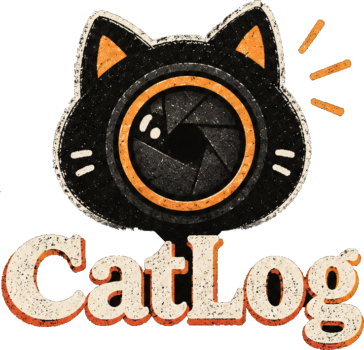

# CatLog

<p align="center">
  
</p>

<p align="center">
  <strong>Who was at the event?</strong><br>
  <em>The privacy-first event photo organizer, face clustering engine, and static gallery generator.</em>
</p>

<p align="center">
  
  
  
  
  
</p>

---

## Overview

**CatLog** is a modern, privacy-first desktop application and static site generator designed for event organizers, conference coordinators, and photographers. 

It takes an event's photo collection, detects faces, extracts mathematical embeddings using **InsightFace** (ArcFace/RetinaFace), groups attendees with high-precision clustering, and provides an interactive visual review interface. Finally, it exports a lightweight, ultra-responsive web gallery where attendees can quickly find all photos they appear in and download the original full-resolution files without file duplication.

---

## Key Features

- **🔒 100% Privacy & Local Processing**  
  All face detection, facial embedding, and clustering algorithms run strictly on your local machine. No attendee biometrics, photos, or personal data are ever uploaded to cloud AI providers.
- **📁 Universal Source Ingestion**  
  Scan photos from **Local Folders**, compressed **ZIP Archives**, or **Google Drive** links (read-only using a public API key, no OAuth/Google login required).
- **🐱 Interactive Mascot & Tour Guide**  
  Features **Camera Cat**, CatLog's signature mascot illustrated across 8 distinct poses and 3 Risograph color themes (*Dark Slate*, *Deep Navy*, and *Riso Paper*). An interactive 11-step spotlight tour walks organizers through key tools, keyboard shortcuts, and clustering sliders.
- **🎯 Visual Review & Smart Suggestions**  
  - **Ranked Merging Suggestions**: Automatically surfaces attendee clusters with similar facial features in the $[0.50, 0.65]$ distance band.
  - **Unrecognized Face Triage**: Rapidly inspect faces that did not automatically attach to clusters; multi-select and assign them to existing people or create new profiles with one click.
  - **Interactive Lightbox with Bounding Boxes**: Click any photo to view detected face boxes with color-coded confidence indicators and on-canvas person reassignment.
  - **Full Undo/Redo**: Safely test threshold adjustments and manual merges with persistent edit replay.
- **🌐 Dual Export Options**  
  - **Standalone Single-File HTML**: An ultra-fast, zero-dependency, single HTML gallery file with embedded CSS, thumbnails, and client-side attendee filtering.
  - **Static Web Bundle**: A complete React web gallery ready for zero-cost deployment to GitHub Pages, Cloudflare Pages, AWS S3, or Netlify.
- **🎨 Public Static Viewer Rework & Per-Person Downloads**  
  - **3 Color Themes**: Instant toggle between *Dark Slate*, *Riso Paper*, and *Deep Navy* with persistent theme memory.
  - **Per-Person Downloads**: Attendees can click "Download all N photos" or enter **Select Mode** to tick specific photos and download a custom selection.
  - **Client-Side ZIP Streaming**: Local exports stream-build a single ZIP using `client-zip` directly in the browser with live progress and cancel—no server required and low memory footprint.
  - **Sequential Google Drive Direct Downloads**: Google Drive exports download photos one by one via direct Drive URLs with clear browser permission prompts and "Open in Drive" fallback. Drive HEIC photos download as JPEG (full pixel dimensions preserved); JPEGs are byte-identical.
  - **Sanitized Filenames**: Downloads follow clean `personname_001.jpg` naming without exposing private directory paths or attendee IDs.
- **🔄 Open Saved Projects**  
  Resume past events instantly! Reopen existing export directories without re-scanning or re-embedding photos.
- **⚡ Zero Photo Duplication**  
  Group photos are indexed once and mapped to every detected attendee. Original photos remain untouched.

---

## Architecture

```
+--------------------------------------------------------------------------+
|  CatLog Desktop Application                                              |
|                                                                          |
|  pywebview Window  --->  React 19 UI (Vite + TypeScript + Tailwind)      |
|                              |  HTTP + SSE Event Stream                  |
|                              v                                           |
|                      FastAPI Server (localhost, random available port)   |
|                              |                                           |
|                              v                                           |
|   Clustering Engine: Scan -> Detect -> Embed -> Cluster -> Re-attach     |
|   InsightFace (buffalo_l) / ArcFace 512D / NumPy / OpenCV                |
|   Google Drive Module: Direct API v3 download & thumbnail fetch          |
+--------------------------------------------------------------------------+
                               |
                               v  (Export Pipeline)
+--------------------------------------------------------------------------+
|  Published Attendee Galleries                                            |
|                                                                          |
|  [Mode A] Single-File Standalone HTML (`index.html` ~ zero-dependency)   |
|  [Mode B] Static Web Bundle (`people.json`, `faces/`, `thumbs/`)         |
|  Attendee Search & Lightbox -> Direct downloads of original images       |
+--------------------------------------------------------------------------+
```

---

## Technology Stack

| Component | Technologies |
|---|---|
| **Desktop Shell** | Python 3.11+, `pywebview` 5.x, Windows Base64 native folder dialogs |
| **Backend API** | FastAPI, Uvicorn, SSE Starlette streaming, Pydantic V2 |
| **Machine Learning** | InsightFace (`buffalo_l`), ONNX Runtime, NumPy, SciPy |
| **Organizer UI** | React 19, TypeScript, Vite, Tailwind CSS, Lucide Icons |
| **Gallery Viewers** | Standalone Single-File HTML5 (Vanilla JS) & Static React Viewer |
| **Testing** | Pytest (99 tests), Vitest (94 tests across 15 suites in Frontend & Viewer) |

---

## Repository Structure

```text
catlog/
├── backend/
│   ├── api/                 # FastAPI backend (endpoints, SSE events, project state, dialogs)
│   ├── drive/               # Google Drive v3 integration (API client, parser, downloads)
│   └── engine/              # Face clustering pipeline
│       ├── detector.py      # InsightFace buffalo_l detection & 512D ArcFace embeddings
│       ├── clusterer.py     # Two-pass Agglomerative clustering & distance thresholding
│       ├── thumbnails.py    # Multi-resolution thumbnail and avatar crop generator
│       ├── exporter.py      # Static web gallery and export bundle generator
│       ├── standalone_html.py # Self-contained single-file HTML gallery compiler
│       ├── edits.py         # Organizer edits, merge history, and split operations
│       ├── cache.py         # Disk embedding cache with facial crop hashes
│       ├── loader.py        # Photo decoder supporting JPEG, PNG, WebP, HEIC/HEIF
│       ├── scanner.py       # Local folder and ZIP archive photo discovery
│       └── pipeline.py      # End-to-end background job execution orchestrator
├── frontend/                # React 19 organizer desktop UI (Vite, TypeScript, Tailwind)
│   ├── public/              # Camera Cat mascots (8 poses x 3 themes), UI textures, brand icons
│   └── src/                 # Review interface, triage view, suggestions, settings, tour
├── viewer/                  # Public static gallery web app for attendees (Vite, React 19)
│   └── src/                 # Attendee search, responsive grid, ZIP streaming, direct downloads
├── docs/
│   └── archive/             # Archived benchmarks, evaluation data, and verification screenshots
├── eval/                    # Standalone verification suites, baseline fixtures, and test runners
├── tests/                   # Backend unit and integration test suite (86 pytest cases)
├── main.py                  # Desktop application entrypoint (webview + uvicorn server)
├── photosorter.spec         # PyInstaller standalone executable specification
├── catlog.ico               # Multi-resolution application icon
└── version_info.txt         # Windows PE executable version resource definition
```

---

## Quick Start (Run from Source)

### Prerequisites

1. **Python 3.11+** installed and available on PATH.
2. **Node.js 18+** & **npm** installed.
3. **Git** for repository cloning.

### Installation

```bash
# 1. Clone repository
git clone https://github.com/Sufiyan-Shiraj/face-clubbing.git
cd face-clubbing

# 2. Setup Python virtual environment & dependencies
python -m venv .venv

# On Windows:
.venv\Scripts\activate
pip install -r requirements.txt

# On macOS/Linux:
source .venv/bin/activate
pip install -r requirements.txt

# 3. Install frontend dependencies & build bundle
cd frontend
npm install
npm run build
cd ..
```

### Launch Desktop Application

**Windows:**
```cmd
run.bat
```
*(Or run `.\.venv\Scripts\python.exe main.py`)*

**macOS / Linux:**
```bash
chmod +x run.sh
./run.sh
```
*(Or run `python3 main.py`)*

---

---

## Standalone Desktop Releases (No Python or Node.js Required)

Portable standalone packages are published for Windows, macOS, and Linux on [GitHub Releases](https://github.com/Sufiyan-Shiraj/face-clubbing/releases).

### Download Table

| Operating System | Architecture | Package Archive | Status | System Requirements |
| :--- | :--- | :--- | :---: | :--- |
| **Windows** | x64 (64-bit) | `CatLog-<version>-windows-x64.zip` | **Stable** | Windows 10 (1809+) or Windows 11; Microsoft Edge WebView2 (pre-installed). Fast onedir archive (~1.6s cold start). |
| **Windows (Onefile)** | x64 (64-bit) | `CatLog-<version>-windows-x64-onefile.zip` | **Alternative** | Single standalone binary archive for comparison / portable thumbdrives. |
| **macOS** | Apple Silicon (`arm64`) | `CatLog-<version>-macos-arm64.zip` | **Beta** | macOS 12 Monterey or later; M1/M2/M3/M4 chip; native WebKit |
| **macOS** | Intel (`x64`) | `CatLog-<version>-macos-x64.zip` | **Beta** | macOS 12 Monterey or later; 64-bit Intel processor; native WebKit |
| **Linux** | x64 (64-bit) | `CatLog-<version>-linux-x64.tar.gz` | **Beta** | glibc 2.31+ (Ubuntu 20.04+, Debian 11+, Fedora 36+); WebKitGTK or default browser |
| **All Platforms** | Checksums | `SHA256SUMS.txt` | &mdash; | SHA-256 integrity manifest for all archives |

### Unsigned Application First-Run Guidance

Because CatLog is distributed as an independent open-source release without commercial code-signing certificates, your operating system will display a security warning on first launch:

- **Windows (Defender SmartScreen)**:
  1. Launching `CatLog.exe` may trigger a blue "Windows protected your PC" dialog.
  2. Click **More info**.
  3. Click **Run anyway**.
- **macOS (Apple Gatekeeper)**:
  1. Double-clicking `CatLog` may show an alert stating it *"cannot be opened because the developer cannot be verified"*.
  2. Right-click (or Control-click) the `CatLog` executable in Finder.
  3. Select **Open** from the context menu, then click **Open** in the confirmation dialog.
  4. Alternatively, navigate to **System Settings** &rarr; **Privacy & Security** &rarr; scroll to Security, and click **Open Anyway**.
- **Linux (Portable Archive)**:
  1. Extract the tarball: `tar -xzf CatLog-<version>-linux-x64.tar.gz`
  2. Ensure execution permissions: `chmod +x CatLog/CatLog`
  3. Launch: `./CatLog/CatLog`
  4. *Browser Fallback*: If WebKitGTK (`gir1.2-webkit2-4.1` or `gir1.2-webkit2-4.0`) is not installed, CatLog will automatically display an informative notice in the terminal and launch the organizer UI directly in your default web browser.

---

### First-Run Model Download (~300 MB)

- **Models are NOT bundled**: To keep download archives portable (~150 MB) and strictly respect upstream non-commercial licensing terms, deep learning model weights are not pre-packaged inside the binaries.
- **Automatic Download**: On the very first event scan, CatLog automatically downloads the official InsightFace `buffalo_l` model pack (~300 MB total) directly from upstream repository mirrors to your local user cache (`~/.insightface/models/buffalo_l/`):
  - `det_10g.onnx` (SCRFD 10G face detector, ~16.8 MB)
  - `w600k_r50.onnx` (ArcFace ResNet50 recognizer, ~170 MB)
  - Ancillary alignment models (~110 MB)
- Subsequent runs reuse the cached weights offline without any internet connection.

---

### Where Projects and Settings Are Stored

- **User Data Directory**: CatLog stores project catalog entries, custom user settings, and application logs in:
  - **`~/.catlog/`** (located in the user's home directory: `%USERPROFILE%\.catlog\` on Windows, `~/.catlog/` on macOS/Linux).
  - `~/.catlog/projects.json`: Metadata catalog of saved projects (names, paths, counts; zero biometric data or photos stored).
  - `~/.catlog/catlog.log`: Diagnostic application log when running in windowed GUI mode.
- **Legacy Migration**: If you previously ran PhotoSorter, CatLog automatically migrates existing settings and project records from `~/.photosorter/` to `~/.catlog/` on first launch.

---

### Privacy Statement & Local Processing Guarantee

- **100% On-Device Processing**: All face detection, feature extraction, 512-dimensional embedding generation, and agglomerative clustering algorithms run entirely locally on your machine's CPU.
- **Zero Cloud Transmission**: No attendee photos, facial crops, biometric templates, or mathematical vectors are ever uploaded to cloud AI providers, external servers, or analytics trackers.
- **Google Drive Integration**: When importing from Google Drive, CatLog uses read-only direct API calls to fetch photo thumbnails and originals directly between your computer and Google's servers. No intermediate proxy servers are involved, and Drive API keys are never written to exported web galleries. Drive HEIC photos download as JPEG (full pixel dimensions preserved); JPEGs are byte-identical.

---

### Headless Engine (CLI Mode)

To run the clustering engine in headless batch mode without the graphical UI:

```bash
python -m backend.engine --input path/to/event_photos --out export --threshold 0.50
```

---

## Export Gallery Bundle

When exporting an event, CatLog outputs a clean, publishable directory:

```
export/
  index.html         # Self-contained standalone gallery or static viewer loader
  config.json        # Event name, theme settings, and accent colors
  people.json        # People clusters, attendee indices, and photo references
  faces/             # Representative square face crops for each attendee
  thumbs/            # Lightweight WebP/JPEG thumbnails for fast browsing
```

To test the generated gallery locally:
```bash
cd export
python -m http.server 8080
```
Open `http://localhost:8080` in your browser.

---

## Mascot & Visual Design System

CatLog features the **Camera Cat** mascot, rendered across 8 dedicated poses and 3 Risograph-inspired themes:

- **Themes**:
  - `t-dark` — **Dark Slate**: High-contrast chalkboard aesthetic with warm chalk-white lines.
  - `t-navy` — **Deep Navy**: Rich editorial blue with warm orange and teal riso accents.
  - `t-paper` — **Riso Paper**: Tactile off-white newsprint aesthetic with misregistered ink offset.
- **Poses**:
  1. *Pose 1*: Hello & Welcome
  2. *Pose 2*: Looking Around & Investigating
  3. *Pose 3*: Pointing to Action
  4. *Pose 4*: Excited Celebration
  5. *Pose 5*: Working Hard at Computer
  6. *Pose 6*: Done & Verified
  7. *Pose 7*: Leaving with Packed Bundle
  8. *Pose 8*: Idle Resting Snooze

All poses are pre-rendered as transparent PNGs under `frontend/public/mascot/` for instantaneous rendering.

---

## Verification & Test Suites

The codebase is backed by 193 automated regression tests and strict metric reproduction checks:

- **Backend Pytest**:
  ```bash
  pytest tests
  # 99 passed in ~11m (100% green, including cold regression benchmarks)
  ```
- **Frontend Vitest**:
  ```bash
  npm --prefix frontend test
  # 13 test files passed, 74 tests passed in ~49s
  ```
- **Viewer Vitest**:
  ```bash
  npm --prefix viewer test
  # 2 test files passed, 20 tests passed in ~5s
  ```
- **Export Verification & Invariant Audit**:
  ```bash
  python eval/verify_export.py
  # 15 / 15 checks and evaluation tables verified
  ```
- **Standalone Binary Smoke Test**:
  ```bash
  python scripts/smoke_test.py
  # Health check and version verification passed
  ```

---

## Privacy, Ethics, and Model Notice

- **Biometric Vector Safety**: Mathematical embeddings (512D unit vectors) are used solely for local distance calculations. No biometric identifiers or templates are shared with third parties.
- **Attendee Consent**: We encourage event organizers to ensure attendee consent prior to publishing galleries online and to use unguessable subdomains or private hosting.
- **InsightFace Pretrained Models**: The pretrained face analysis models (e.g. `buffalo_l`) are provided by the InsightFace project and are intended strictly for non-commercial research and educational use. For commercial deployments, consult InsightFace's licensing or substitute a commercially licensed recognition model. See [THIRD_PARTY_NOTICES.md](THIRD_PARTY_NOTICES.md) for full notices.

---

## License

CatLog's application code is licensed under the [MIT License](LICENSE).
Third-party libraries and component licenses are detailed in [THIRD_PARTY_NOTICES.md](THIRD_PARTY_NOTICES.md).
